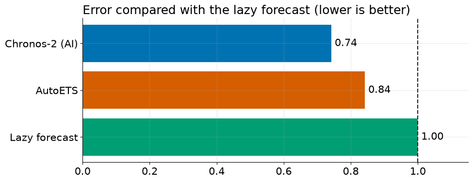

# Episode 1: Can AI Predict Tomorrow?

**Will 2 pm tomorrow in Accra be as hot as today?** We race an AI forecasting model, Amazon's **Chronos-2**, against the laziest forecast possible ("same as yesterday") and a classic statistics model, on 56 days of real data. The AI wins, but there's a catch most people never check.

## What you'll learn

1. What forecasting really is (you already do it every day)
2. What a **time series** is, and its three ingredients: **trend, seasonality and noise**
3. Two golden rules: **never shuffle time**, and **ranges beat single numbers**
4. The **lazy forecast** every model must beat
5. How an **AI foundation model** reads numbers, and what **zero-shot** means
6. How to run a **fair race** (backtesting) in Python
7. **Three checks** before you trust any AI forecast

No maths background needed. If you can read a chart, you can follow along.

## Use the notebook

| I want to… | Do this |
|---|---|
| **Read along** | Open [`can_ai_predict_tomorrow.ipynb`](can_ai_predict_tomorrow.ipynb). Every output is saved, so you can read it without running anything |
| **Run it myself, nothing to install** | Click **Open in Colab** above, then **Runtime → Run all**. It takes a few minutes (most of it installing the libraries), and no GPU is needed |
| **Run it on my computer** | `pip install -r ../../requirements.txt`, then open the notebook in Jupyter or VS Code |

## The race

| Contestant | What it does |
|---|---|
| **Lazy forecast** (seasonal naive) | 2 pm tomorrow = 2 pm today |
| **AutoETS** | A classic statistics model built from Error, Trend and Seasonality |
| **Chronos-2** | An AI foundation model, used **zero-shot**: it was never trained on this data |

Every model gets the same 4 weeks of history and forecasts the next 24 hours, on 56 different days, using only the past each time.

## What we found

| Model | Average error | Error vs lazy forecast | Days beating the lazy forecast | 80% range caught the truth |
|---|---:|---:|---:|---:|
| **Chronos-2** | 0.46 °C | 0.74 | 45 of 56 | 74.7% |
| **AutoETS** | 0.52 °C | 0.84 | 41 of 56 | 79.8% |
| **Lazy forecast** | 0.62 °C | 1.00 | n/a | 82.7% |

- **The AI won:** about 26% less error than "same as yesterday". A bootstrap over the 56 days shows the win is very unlikely to be luck.
- **But it was overconfident:** its 80% ranges caught the real temperature only 74.7% of the time. The best guess and the most honest range are not the same thing.
- This is **one city in one season**. Treat it as evidence for this data, not a universal ranking, and re-check on your own data.

## Three checks before you trust any AI forecast

1. **Beat the lazy forecast.** Always compare with "same as yesterday" (or "same week last year") first.
2. **Test on many days, not one lucky week.** Backtest, using only the past each time.
3. **Check the ranges, not just the line.** Coverage tells you if the model knows what it doesn't know.

## Files

| File | What it is |
|---|---|
| [`can_ai_predict_tomorrow.ipynb`](can_ai_predict_tomorrow.ipynb) | The slides and the code, in the order of the video |
| [`data/`](data/) | Accra hourly weather, 1 Aug to 25 Oct 2026 ([source and licence](data/README.md)) |
| [`figures/`](figures/) | The diagrams used on the slides |

## Credits

- Weather data by [Open-Meteo.com](https://open-meteo.com/) (CC BY 4.0).
- [Chronos-2](https://huggingface.co/amazon/chronos-2) by Amazon (Apache-2.0). [StatsForecast](https://github.com/Nixtla/statsforecast) by Nixtla.
- This episode is based on my masterclass for [Developers in Vogue](https://www.developersinvogue.org/). The full masterclass materials, with exercises and a deeper look at the results, are at [div-forecasting-masterclass](https://github.com/RichelCode/div-forecasting-masterclass).

---

**Next episode:** Time Series Forecasting Explained Simply (trend, seasonality and noise). Coming soon.
