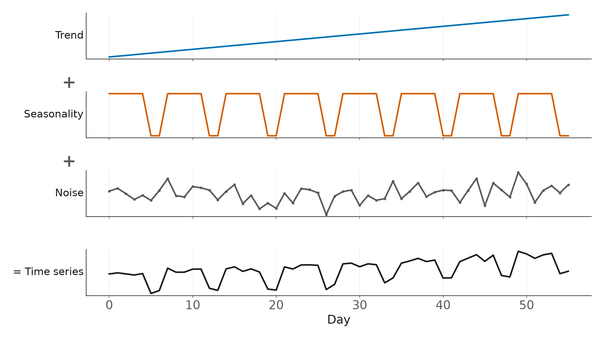

# Episode 2: Time Series Forecasting Explained Simply

**Every forecast is made of three ingredients: trend, seasonality and noise.** Learn to spot them, and you know what any forecast has to get right, before you touch a single model. We take two real series apart in Python: daily bikes crossing a bridge in Seattle, and hourly temperature in Accra.

## What you'll learn

1. The **recipe** behind every time series: trend + seasonality + noise
2. **Trend:** which way is it going?
3. **Seasonality:** what repeats, and how often (daily, weekly, yearly)?
4. The difference between **seasonality and a cycle**
5. **Noise:** why you can't predict it, but can measure it
6. How to **take a series apart** with **STL** and **MSTL** in Python
7. How to score **how strong** each ingredient is, from 0 to 1
8. **Additive vs multiplicative** seasonality, and why real data rarely fits the textbook

No maths background needed.

## Use the notebook

| I want to… | Do this |
|---|---|
| **Read along** | Open [`trend_seasonality_noise.ipynb`](trend_seasonality_noise.ipynb). Every output is saved |
| **Run it myself, nothing to install** | Click **Open in Colab** above, then **Runtime → Run all**. It runs in under a minute |
| **Run it on my computer** | `pip install -r ../../requirements.txt`, then open the notebook in Jupyter or VS Code |

## What we found

**Fremont Bridge bikes, January 2023 to September 2026**

- **Trend:** up. January to September averages grew by about **39%** from 2023 to 2026
- **Weekly rhythm:** busiest on Tuesdays, quietest on Sundays. The busiest weekday has about **1.8x** the bikes of the quietest
- **Yearly rhythm:** summer high, winter low. The busiest month has about **2.9x** the bikes of the quietest
- **Noise:** a typical surprise is about **±400 bikes** a day. Many of the biggest drops are rainy days and public holidays, like 4 July

**Accra temperature, August to October 2026**

- A strong **daily rhythm**: a typical day swings about **5.4 °C** from the coolest hour to the hottest
- Small **noise**, typically about **±0.5 °C**

**How strong is each ingredient?** (0 = drowned in noise, 1 = very clear)

| Series | Trend | Daily | Weekly | Yearly |
|---|---:|---:|---:|---:|
| Accra temperature (hourly) | 0.81 | 0.93 | | |
| Fremont bikes (daily) | 0.41 | | 0.71 | 0.85 |

## Three questions to ask before you forecast anything

1. **Which way is it going?** (trend)
2. **What repeats, and how often?** (seasonality)
3. **How big are the surprises?** (noise, which sets the width of your forecast range)

## Files

| File | What it is |
|---|---|
| [`trend_seasonality_noise.ipynb`](trend_seasonality_noise.ipynb) | The slides and the code, in the order of the video |
| [`data/`](data/) | The bike counts and the Accra temperature ([sources and licences](data/README.md)) |
| [`figures/`](figures/) | The diagrams used on the slides |

## Credits and further reading

- Bike counts: [Fremont Bridge Bicycle Counter](https://data.seattle.gov/d/65db-xm6k), City of Seattle Open Data (public domain).
- Weather data by [Open-Meteo.com](https://open-meteo.com/) (CC BY 4.0).
- STL and MSTL from [statsmodels](https://www.statsmodels.org/).
- The strength measure is from Rob J Hyndman and George Athanasopoulos, [*Forecasting: Principles and Practice*](https://otexts.com/fpp3/) (3rd edition), a free online book and a great next step.

---

**Previous episode:** [Can AI Predict Tomorrow?](../01-can-ai-predict-tomorrow/) · **Next episode:** [Build Your First Demand Forecast in Python, Step by Step](../03-first-demand-forecast/)
