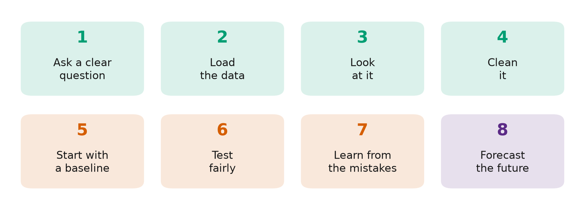

# Episode 3: Build Your First Demand Forecast in Python, Step by Step

**How many bikes will cross the bridge next week?** We build a complete demand forecast in 8 steps, from loading raw data to a forecast for next week with a range you can plan around. Real data: daily bike counts on Seattle's Fremont Bridge, January 2023 to September 2026.

## The 8 steps

1. **Ask a clear question:** what, how far ahead, how often, for which decision
2. **Load** the data in the `unique_id`, `ds`, `y` format
3. **Look** at it: trend, rhythms, anything strange
4. **Clean** it: missing days, broken readings
5. **Start with a baseline:** "same day last week"
6. **Test fairly:** backtest on 26 weeks, using only the past each time
7. **Learn from the mistakes:** what do the worst days have in common?
8. **Forecast the future, with a range**

## Use the notebook

| I want to… | Do this |
|---|---|
| **Read along** | Open [`first_demand_forecast.ipynb`](first_demand_forecast.ipynb). Every output is saved |
| **Run it myself, nothing to install** | Click **Open in Colab** above, then **Runtime → Run all**. It takes a few minutes (most of it installing the libraries), and no GPU is needed |
| **Run it on my computer** | `pip install -r ../../requirements.txt`, then open the notebook in Jupyter or VS Code |
| **Use my own data** | Replace the CSV with yours, keep the `unique_id`, `ds`, `y` columns, and change `H` and `SEASON` in the settings cell |

## What we found

Each model forecast 7 days ahead, on 26 different weeks from April to September 2026, using only the data before each week.

| Model | Average error (bikes per day) | Error as % of a typical day | Error vs baseline | Weeks beating the baseline | 80% range caught the truth |
|---|---:|---:|---:|---:|---:|
| **Chronos-2** (AI, zero-shot) | 624 | 14.4% | 0.73 | 20 of 26 | 72.5% |
| **AutoETS** | 770 | 17.8% | 0.90 | 15 of 26 | 66.5% |
| **Same day last week** (baseline) | 856 | 19.8% | 1.00 | n/a | 69.8% |

- **The AI won:** about 27% less error than "same day last week", and it won 20 of the 26 weeks.
- **The worst days were not random.** Most were **rainy days** or **public holidays** (Memorial Day, Labor Day): information the model did not have. One miss went the other way: Monday 6 July was much busier than forecast.
- **All three ranges were overconfident:** they caught the truth less than 80% of the time.

**The forecast for 1 to 7 October 2026** (Chronos-2, rounded to the nearest 10):

| Day | Forecast | 80% range |
|---|---:|---|
| Thu 1 Oct | 4,530 | 3,640 to 5,130 |
| Fri 2 Oct | 3,990 | 3,040 to 4,690 |
| Sat 3 Oct | 3,180 | 2,330 to 3,950 |
| Sun 4 Oct | 2,770 | 1,990 to 3,520 |
| Mon 5 Oct | 4,100 | 3,150 to 4,810 |
| Tue 6 Oct | 4,640 | 3,740 to 5,290 |
| Wed 7 Oct | 4,480 | 3,550 to 5,160 |

This is one bridge in one city. Treat it as evidence for this data, and test on your own.

## Files

| File | What it is |
|---|---|
| [`first_demand_forecast.ipynb`](first_demand_forecast.ipynb) | The slides and the code, in the order of the video |
| [`data/`](data/) | Bike counts and Seattle weather ([sources and licences](data/README.md)) |
| [`figures/`](figures/) | The diagrams used on the slides |

## Credits

- Bike counts: [Fremont Bridge Bicycle Counter](https://data.seattle.gov/d/65db-xm6k), City of Seattle Open Data (public domain).
- Weather data by [Open-Meteo.com](https://open-meteo.com/) (CC BY 4.0).
- [Chronos-2](https://huggingface.co/amazon/chronos-2) by Amazon (Apache-2.0). [StatsForecast](https://github.com/Nixtla/statsforecast) by Nixtla.

---

**Previous episode:** [Time Series Forecasting Explained Simply](../02-trend-seasonality-noise/) · **Next episode:** The Forecasting Mistake That Fakes Good Results (data leakage)
