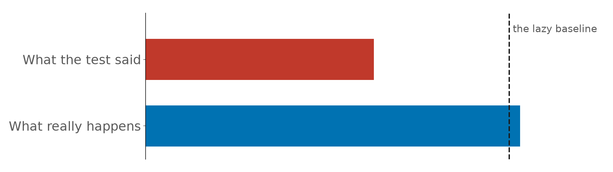
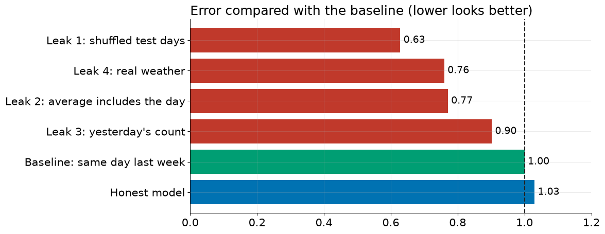
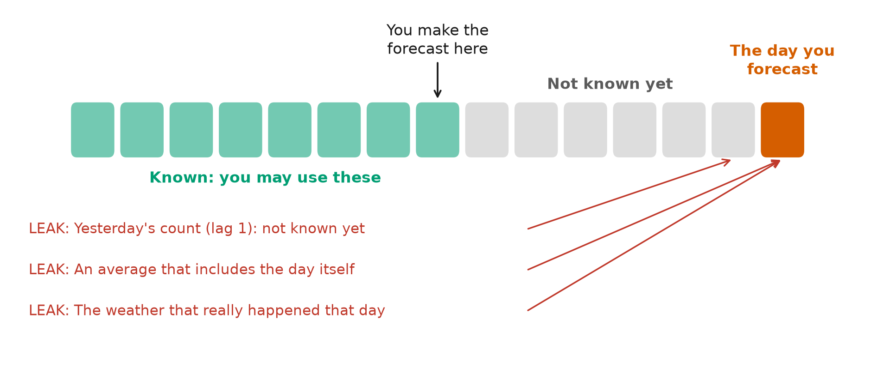

# Episode 4: The Forecasting Mistake That Fakes Good Results

**Same model, same data, two very different scores.** Tested the wrong way, a machine learning model looks far better than a lazy forecast. Tested honestly, it is slightly worse. The difference is **data leakage**. We make it happen four different ways in Python, then learn the one question that catches almost every leak.

## What you'll learn

1. What **data leakage** is, and why it makes your score **better** instead of worse
2. How to build **honest features** with `shift()`
3. **Four leaks**, each shown in code on real data
4. The **one question** that catches almost every leak
5. A **checklist** to run before you trust any forecast score

## Use the notebook

| I want to… | Do this |
|---|---|
| **Read along** | Open [`data_leakage.ipynb`](data_leakage.ipynb). Every output is saved |
| **Run it myself, nothing to install** | Click **Open in Colab** above, then **Runtime → Run all**. It runs in under a minute |
| **Run it on my computer** | `pip install -r ../../requirements.txt`, then open the notebook in Jupyter or VS Code |

## The experiment

- **Data:** daily bikes crossing Seattle's Fremont Bridge, January 2023 to September 2026
- **Task:** forecast each day **one week ahead**
- **Model:** gradient boosting (scikit-learn's `HistGradientBoostingRegressor`)
- **Honest test:** train before 1 April 2026, test on 1 April to 30 September 2026
- **Baseline:** "same day last week"

## What we found

| Version | Error (bikes per day) | Error vs baseline | Honest? |
|---|---:|---:|---|
| Leak 1: test days picked at random (shuffled) | 539 | 0.63 | No |
| Leak 4: the weather that really happened | 652 | 0.76 | No |
| Leak 2: a 7-day average that includes the day itself | 661 | 0.77 | No |
| Leak 3: yesterday's count, in a week-ahead forecast | 774 | 0.90 | No |
| Baseline: same day last week | 858 | 1.00 | Yes |
| **Honest model** | **884** | **1.03** | **Yes** |

- **Every leak turned a losing model into a "winner".** Only the honest test shows the truth: this model is slightly worse than the baseline.
- **Why the honest model lost:** tree models cannot forecast values above what they saw in training, and 2026 was a record year (busiest test day 6,755 bikes; busiest training day 5,778).
- **The shuffled test looked best of all,** and it is the easiest mistake to make. Its exact score depends on which days are drawn, but it is always far "better" than the honest one.

## The one question

> **Would I know this, at the moment I make the forecast?**

Ask it about every feature, and about how you split the data.

## Leakage checklist

1. **Too good to be true?** Compare with a baseline. A huge jump is a red flag
2. **Split by time, always.** Train on the past, test on the future
3. **For every feature, ask the one question**
4. **Shift first, then roll.** Averages must end before the forecast is made
5. **Use forecasts, not actuals,** for anything about the future (weather, prices, events)

## Files

| File | What it is |
|---|---|
| [`data_leakage.ipynb`](data_leakage.ipynb) | The slides and the code, in the order of the video |
| [`data/`](data/) | Bike counts and Seattle weather ([sources and licences](data/README.md)) |
| [`figures/`](figures/) | The diagrams used on the slides |

## Credits

- Bike counts: [Fremont Bridge Bicycle Counter](https://data.seattle.gov/d/65db-xm6k), City of Seattle Open Data (public domain).
- Weather data by [Open-Meteo.com](https://open-meteo.com/) (CC BY 4.0).
- Model: [scikit-learn](https://scikit-learn.org/).

---

**Previous episode:** [Build Your First Demand Forecast in Python](../03-first-demand-forecast/) · **Next episode:** coming soon
